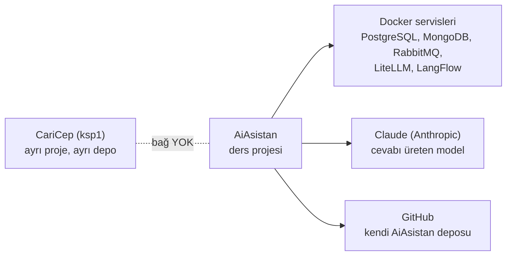
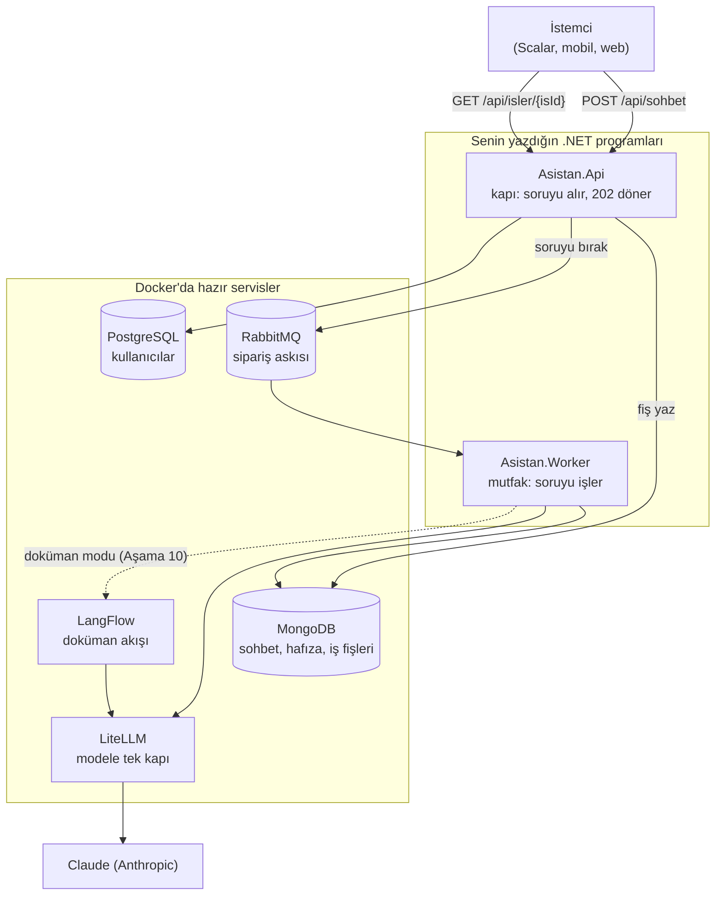
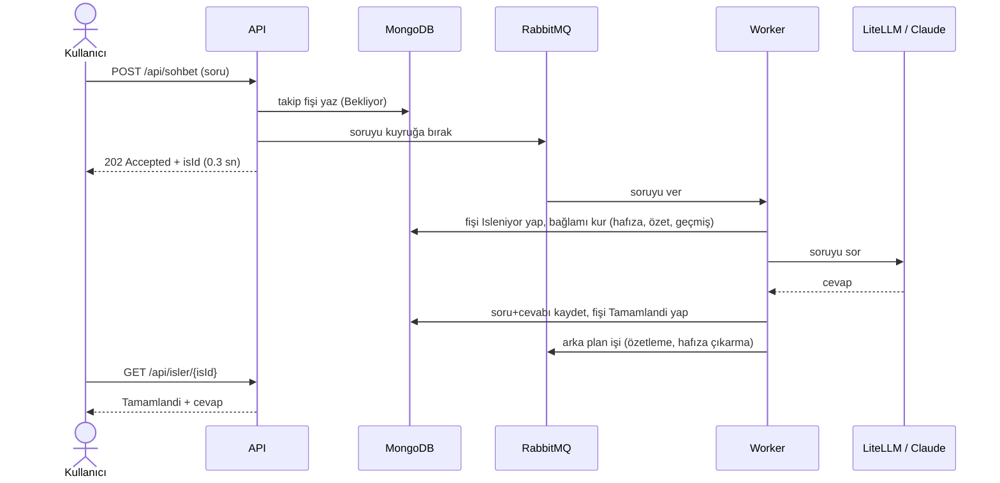
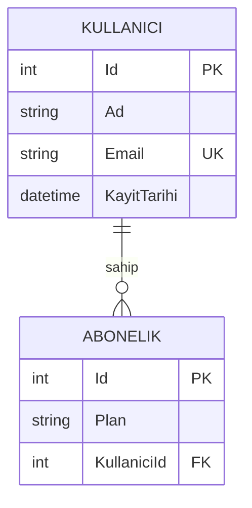
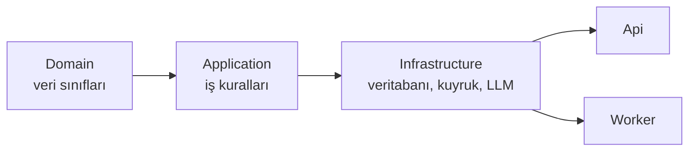

# 07 · Tasarım ve mimari: bu proje ne, nereye bağlı?

Bu sayfadaki diyagramlar [Mermaid](https://mermaid.js.org) ile yazıldı: **GitHub'da ve Visual Studio Code'da kod olarak değil, çizim olarak görünür.**

## 1. Bu proje ne?

**AiAsistan, bir yapay zekâ sohbet servisidir (arka uç / API).** Bir kullanıcı soru sorar; servis soruyu Claude'a iletir, cevabı getirir, **konuşmayı ve kullanıcıyı hatırlar**. Ekranı (arayüzü) yoktur; başka bir program (mobil uygulama, web sitesi) ona HTTP ile bağlanır. Kendi başına denemek için tarayıcıda küçük bir test sayfası vardır (Scalar, `/scalar/v1`).

**Neden var?** Gerçek bir ürün değil, bir **ders projesi**. "Yazılım Geliştirme Rehberi: .NET'ten AI'ya" rehberindeki on konuyu (.NET, EF Core, Docker, MongoDB, RabbitMQ, LiteLLM, LangFlow, AI hafızası, Git/GitHub, CI/CD) **tek bir çalışan projede** birleştirerek öğretir.

## 2. Nereye bağlı? Başka projelerle ilişkisi

AiAsistan **bağımsız bir projedir**: kendi klasörü (`source/repos/AiAsistan`), kendi Git reposu, kendi çözüm dosyası (`.sln`), kendi veritabanları ve kendi GitHub deposu vardır. CariCep (`ksp1`) ve diğer projelerle hiçbir kod, klasör veya depo bağı yoktur.

| Soru | Cevap |
|---|---|
| CariCep koduna dokunuyor mu? | Hayır |
| CariCep'in veritabanını kullanıyor mu? | Hayır, kendi PostgreSQL/MongoDB'si var (Docker'da) |
| Git deposu aynı mı? | Hayır. AiAsistan'ın kendi deposu var |
| İleride CariCep ile bağlanabilir mi? | Evet: CariCep, AiAsistan API'sini HTTP ile çağırarak bir "yapay zekâ asistanı" özelliği alabilir. Bu henüz yapılmadı ve senin kararın |

## 3. İçinde ne çalışır? (kapsayıcı görünümü)

## 4. Bir soru nasıl cevaplanır? (sıra diyagramı)

## 5. Veri nerede saklanır? (veri modeli)

İki farklı veritabanı var, çünkü iki farklı türde veri var: **ilişkili ve titiz** veri PostgreSQL'de, **çok ve esnek** veri MongoDB'de.

MongoDB koleksiyonları (şemasız belgeler):

| Koleksiyon | Ne tutar | Bağlantı anahtarı |
|---|---|---|
| `mesajlar` | Her soru ve her cevap | `oturumId`, `kullaniciId` |
| `oturumOzetleri` | Bir sohbetin eski kısmının özeti | `oturumId` (tek) |
| `hafizalar` | Kullanıcı hakkında kalıcı bilgiler | `kullaniciId` |
| `isler` | Sorunun takip fişi (Bekliyor → Tamamlandi) | `_id` = `isId`, 7 gün sonra silinir |

## 6. Katmanlar (kod içindeki düzen)

Oklar "bilir" demektir: Domain hiçbir şeyi bilmez, Application sadece Domain'i bilir. Ayrıntı: `01-proje-haritasi.md`.

## 7. Bu tasarımda bilerek yapılmayanlar

- **Arayüz yok.** Ekran tasarımı (Figma, Windows Forms, Razor sayfası) bu projede yoktur; sadece API'dir.
- **Kimlik doğrulama yok.** Kullanıcı kimliğini bilen herkes o kullanıcının oturumunu ve hafızasını görebilir.
- **Tek makine.** Her şey bilgisayarında Docker ile çalışır. API ve Worker imajları ve CD hazır (`.github/workflows/cd.yml`), ama gerçek bir sunucu yok; yayın adımı `DEPLOY_ENABLED` düğmesiyle kapalı.
